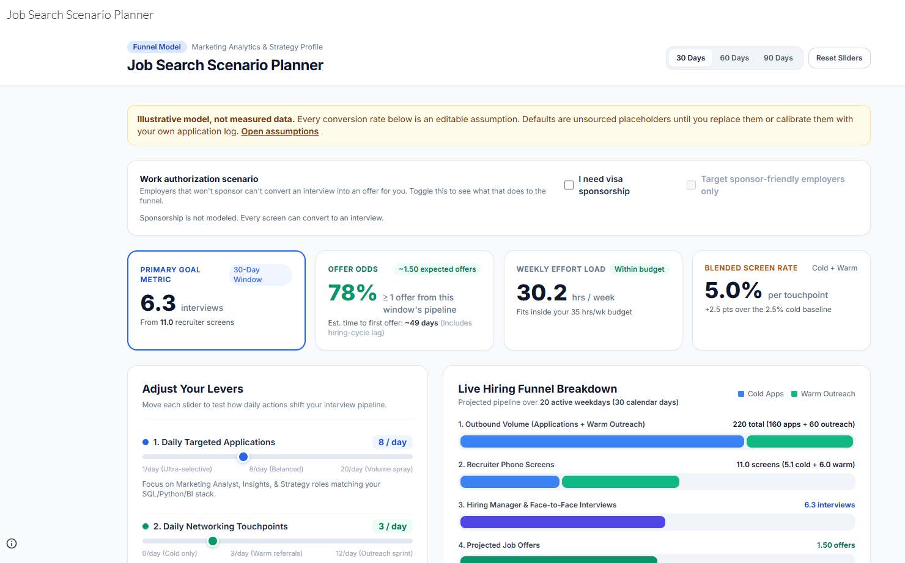

# Job Search Scenario Planner

An interactive funnel model for testing how daily job-search habits (applications, networking outreach, prep time, study time) change the number of screens, interviews and offers you can expect over 30, 60 or 90 days. It also has a visa-sponsorship scenario, because employers that can't sponsor can't convert an interview into an offer for candidates who need it.

**Live demo:** https://sushantdai.github.io/-job-search-planner/

## What it does

- **Four levers:** daily targeted applications, daily networking touchpoints, weekly tailoring and interview-prep hours, daily upskilling hours.
- **Live outputs:** projected recruiter screens, interviews, expected offers, odds of at least one offer, estimated time to first offer, and weekly effort load against your own hours budget.
- **Strategy comparison:** your live settings next to three benchmark strategies (high-volume cold apply, study-first, warm outreach plus tailoring), with one-click loading into the sliders.
- **Sponsorship scenario:** compares a broad search against a sponsor-friendly-only search and shows how many interviews survive each.
- **Calibration:** enter your own application log and the model back-solves its baseline rates so it matches what you actually observed.

## Important: the defaults are placeholders

Every conversion rate in this model is an editable assumption. The default values are **unsourced placeholders**, not measured data. They exist so the tool works on first load. Replace them with your own numbers or published figures, and record the source in the Source column of the Assumptions table.

| Assumption | Default |
|---|---|
| Cold application → recruiter screen | 2.5% |
| Warm outreach → screen / intro call | 9.5% |
| Screen → interview (baseline) | 48% |
| Screen → interview ceiling | 75% |
| Prep effect on screen → interview (at 15 hrs/wk) | +22 pts |
| Interview → offer (baseline) | 20% |
| Interview → offer ceiling | 35% |
| Prep effect on interview → offer (at 15 hrs/wk) | +10 pts |
| Tailoring lift on screen rates per 10 hrs/wk | 42% (cap 55%) |
| Upskilling lift at 30 / 60 / 90 days (at 3 hrs/day) | 3% / 11% / 22% |
| Minutes per application / per outreach message | 22 / 18 |
| Hiring-cycle lag (application → offer) | 35 days |
| Weekly hours budget | 35 |
| Sponsor-capable share of cold applications (broad search) | 35% |
| Sponsor-capable share of warm outreach (broad search) | 50% |
| Sponsor-friendly roles findable per day | 6 |

The sponsorship results depend heavily on the last three rows. Treat them as inputs to replace, not findings.

## How the model works

1. Touchpoints = daily applications and outreach × active weekdays (2 of every 3 calendar days).
2. Screens = cold applications × cold screen rate + outreach × warm screen rate. Tailoring hours and upskilling raise both rates. Sending more than about 12 applications a day, or exceeding about 42 hours a week, applies a quality penalty.
3. Interviews = screens × screen-to-interview rate, which rises with prep hours. With sponsorship on, only screens at employers that can sponsor count.
4. Expected offers = interviews × interview-to-offer rate. Odds of at least one offer = 1 − e^(−expected offers), a Poisson approximation.
5. Time to first offer = hiring-cycle lag + the time needed to accumulate about 0.7 expected offers. Offer odds describe the pipeline built in the window, and offers usually land after the window ends.

## Calibrating with your own data

Open "Calibrate with my own application log", enter your totals, and click "Apply my rates". Rates are only updated when there is enough data: at least 40 cold applications, 15 outreach messages, 8 screens and 6 interviews. Baselines are back-solved so the model reproduces your observed rate at your current slider settings.

## Known limitations

- No seasonality, no correlation between applications, no learning effect.
- Poisson approximation assumes independent outcomes.
- Prep and upskilling effects are simple curves, not fitted to data.
- Use outputs to compare strategies against each other, not as predictions.

## Run it locally

It is a single HTML file. Open `index.html` in a browser. Tailwind CSS and the Inter font load from CDNs, so you need an internet connection.

## Built with

Started in Google's AI Skills Studio on Handshake, then edited and extended by me: editable assumptions with source notes, the sponsorship scenario, hiring-cycle lag, the hours budget, and calibration from a personal application log.

## Author

Sushant Bhatta · [LinkedIn](https://www.linkedin.com/in/sushantbhatta7) · [Portfolio](https://sushantbhatta.com.np)
